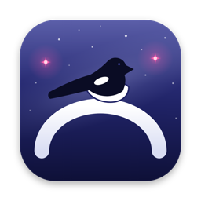

<p align="center">
  
</p>

<h1 align="center">Ojak</h1>

<p align="center"><strong>Your Claude Code and Codex accounts, in one place.</strong></p>

<p align="center">
  <a href="https://github.com/lapalai/ojak/releases/latest"><strong>Download</strong></a> ·
  <a href="#get-started">Get started</a> ·
  <a href="docs/usage.md">User guide</a> ·
  <a href="https://github.com/lapalai/ojak/issues">Report a bug</a>
</p>

<p align="center">
  <strong>English</strong> · <a href="docs/README.ko.md">한국어</a> · <a href="docs/README.id.md">Bahasa Indonesia</a>
</p>

<p align="center">
  <a href="https://github.com/lapalai/ojak/releases/latest"></a>
  <a href="https://github.com/lapalai/ojak/actions/workflows/ci.yml"></a>
  <a href="LICENSE"></a>
</p>

Ojak is a **macOS menu bar and Windows system tray app** for managing your own Claude Code and Codex subscription accounts. Check remaining usage and reset times in one place, then run `claude` or `codex` as usual. Once terminal integration is set up, Ojak picks an available account for each new session.

**Free and open source.** Install the official Claude Code or Codex CLI first and connect your own account. Provider subscriptions and usage charges are separate.

> **Early preview.** Installation and behavior may change. Ojak is unofficial and is not affiliated with Anthropic, OpenAI, Google, or xAI. Use only accounts you own. It does not increase or bypass provider limits. [Read the disclaimer](#disclaimer).

## Why Ojak?

- **See your accounts at a glance.** Check remaining usage and reset times without switching between accounts.
- **Keep your terminal workflow.** Use the official CLIs with the same `claude` and `codex` commands. A running conversation keeps its assigned account.
- **You decide when to switch.** When a managed CLI session exits after exhausting its quota, Ojak can offer to reopen the conversation on another eligible account. Nothing moves on its own.
- **Understand your usage.** View token counts and API-price estimates from omp, Claude Code, and Codex session logs on your computer. Estimates are not your actual subscription bill; models without known prices are marked separately.

The app supports **English, Korean, and Indonesian**. Some CLI, service, and installer messages are still in Korean.

## Let your coding agent install Ojak

Paste this into Claude Code, Codex, or omp with local shell access:

```text
Install and configure Ojak for my computer using this guide. Preserve my existing settings and logins, and verify the setup:
https://raw.githubusercontent.com/lapalai/ojak/main/docs/install-for-agents.md
```

Want omp integration too? Add “Also connect my existing omp installation.” It is optional and off by default; read the [disclaimer](#disclaimer). Login approvals and OS security prompts may still need your input. The agent must not force-stop running work to update Ojak.

Prefer to install it yourself? Follow the terminal instructions for [Mac](docs/usage.md#advanced-macos-installation) or [Windows](docs/usage.md#windows-terminal-installation), or download an installer below. [Agent installation details](docs/install-for-agents.md).

## Download

Get the installer from the [latest release](https://github.com/lapalai/ojak/releases/latest). The link stays the same when a new version comes out.

| Platform | Download file | Requirements |
|---|---|---|
| macOS | `Ojak_<version>_aarch64.dmg` | macOS 13+, Apple silicon (M-series) |
| Windows (preview) | `Ojak_<version>_x64-setup.exe` | Windows 10 1809+ or Windows 11, x64; WebView2 required |

No Intel Mac or Linux build is available. WebView2 is included with Windows 11; Windows 10 may need it installed separately.

### macOS

1. Open the DMG and drag **Ojak** into **Applications**.
2. Open Ojak. The app is ad-hoc signed, not Apple-notarized. If macOS blocks it as an unidentified developer, verify that you downloaded it from this repository, then use **System Settings → Privacy & Security → Open Anyway**.
3. Follow the setup steps below. An update may cause macOS to ask for permission again.

### Windows

1. If you use Orca or omp, **quit them completely before installing or updating**. Closing an Orca window may leave omp running.
2. Run the installer as your normal Windows user. **Do not choose “Run as administrator.”**
3. The installer is unsigned. If SmartScreen appears, verify the download source before choosing **More info → Run anyway**. Do not disable your antivirus. If it flags a file or setup stops, use the [installation troubleshooting guide](docs/usage.md#windows-installation).

## Get started

1. **Open Ojak and select Start.** This sets up the background service and connects your terminal commands.
2. **Connect your accounts.** Ojak looks for existing Claude Code and Codex logins on this computer. If needed, use the app's sign-in action to open the official provider login. Add more accounts under **Connections**.
3. **Open a new terminal** in your project and run either command:

   ```sh
   claude
   # or
   codex
   ```

   On Mac, setup can open a terminal with the command already entered; press Enter to run it. On Windows, copy the command into a new terminal.

4. **Check Sessions** to see which account Ojak selected.

If setup is incomplete, the getting-started card shows what's left. If no account is eligible, do not assume Ojak is managing the session: [check the CLI message and allocation reasons](docs/usage.md#account-selection).

**Already use omp?** The integration is optional and off by default. You do not need it for CLI account selection. It relays subscription credentials through a local proxy and may conflict with provider terms. Read the [setup instructions and risks](docs/usage.md#omp-integration) before enabling it.

## Privacy and account safety

Ojak stores its account records, settings, and diagnostic logs on your computer. **Ojak does not send usage telemetry or automatically upload diagnostics.** Ojak still needs the network: sign-in, usage checks, and model requests communicate with providers, and update checks contact GitHub.

- Each new managed session is assigned an account; Ojak does not silently move a running conversation to another account.
- If Ojak cannot confirm that a session ended, it keeps the account's slot reserved rather than risking a conflicting assignment.
- Token-cost estimates are not invoices. Optional Codex credits and Claude extra usage can incur provider charges; their use for new assignments is off by default. Ojak cannot cap charges incurred by an already-running official CLI.

See [data locations, billing limits, and troubleshooting](docs/usage.md) and the [security policy](SECURITY.md).

## Disclaimer

Use only accounts you own. Do not use Ojak to share accounts or evade limits. You are responsible for complying with provider terms; account restrictions or suspension are possible. This project does not guarantee that any particular use is permitted or risk-free.

The optional omp integration passes subscription credentials through a local proxy and may conflict with provider terms. Review [Anthropic's legal and compliance information](https://code.claude.com/docs/en/legal-and-compliance) and [OpenAI's terms of use](https://openai.com/policies/row-terms-of-use/).

## Documentation and contributing

- **Using Ojak:** [English guide](docs/usage.md) · [한국어 안내](docs/usage.ko.md) · [Panduan Bahasa Indonesia](docs/usage.id.md)
- **What's changed:** [Changelog](CHANGELOG.md) (Korean)
- **Build and contribute:** [Contributing](CONTRIBUTING.md) (English / Korean)
- **Architecture:** [Domain index](docs/domains/INDEX.md) · [Release policy](docs/release-policy.md) (Korean)
- **Community:** [Code of conduct](CODE_OF_CONDUCT.md) · [Report a security issue privately](SECURITY.md)

To build locally, follow the prerequisites in [Contributing](CONTRIBUTING.md), then run `npm ci` and `npm run build` from the repository root.

## Behind the name

Ojak takes its name from **Ojakgyo**, the bridge of crows and magpies in Korean folklore. Once a year, the birds bring two separated lovers together across the Milky Way. Our bridge connects your work to the right account.

Made by [lio](https://github.com/Liopark) at [lapal](https://github.com/lapalai). Licensed under [MIT](LICENSE). [Third-party notices](THIRD_PARTY_NOTICES.md).
