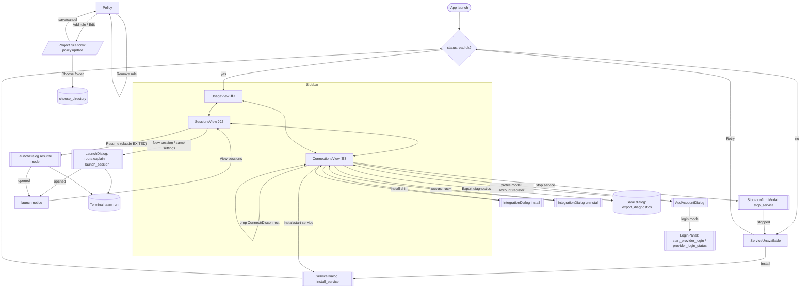

# desktop (`apps/desktop`)

## 개요
Tauri 2 + React 19/Vite 메뉴바 앱(제품명 Ojak, bundle id `ai.aam.desktop`). WebView는 허용된 RPC와 고정 Tauri 명령으로만 서비스에 닿는다. 관리 작업은 앱 안의 `aam` 바이너리를 실행한다.

## 화면 (`src/`)
| 메뉴 | 파일 |
|---|---|
| 사용 현황 | `UsageView.tsx`, `AccountRow.tsx`(계정 목록 `AccountRow`, 앱 내부 상세 `AccountDetails`), `usage-activity.ts`(확인된 실행 집계). 계정 상태가 먼저이며 omp 요청·기간은 접힌 이력 안에 둔다. 계정 선택·유료 사용·배정 설정은 앱 안의 대화상자다. |
| 세션 | `SessionsView.tsx` |
| 연결 | `ConnectionsView.tsx` |
| 토큰·비용 | `TokenUsageView.tsx`, `local-usage.ts`(순수 규칙), 네이티브 `src-tauri/src/local_usage.rs`. 이 PC의 omp·Claude CLI·Codex JSONL을 `AAM_HOME/local-usage.sqlite3`에 증분 색인(숫자·시각·모델·해시 ID만). 처음 읽기는 낮은 우선순위 백그라운드 스레드가 창과 무관하게 끝까지 진행하고, 진행률은 읽은 바이트 기준. 오늘·이번 달·전체에 실제 날짜 범위 표시. 환산액은 API 가격 기준이며 청구액이 아니다. |
로그인·다시 로그인은 모두 앱이 소유하는 작업이다(`LoginDialog.tsx`의 `LoginPanel`, `login.ts` 순수 규칙). 사용자가 [공식 로그인 열기]를 누르면 `start_provider_login({provider, accountId?, label?, settingsDigest?})`가 작업을 만들고, 화면은 `provider_login_status({id})`를 1초마다 읽어 시작 중→브라우저 대기→계정 확인→한도·omp 반영→성공/실패/취소를 구분해 보인다. 브라우저를 열었다는 사실은 성공이 아니며, 성공(`succeeded`)은 네이티브가 정확한 계정을 확인한 뒤에만 오고 그때에만 스냅샷을 다시 읽는다. 창을 닫아도 작업은 계속된다. 다시 열면 `list_provider_logins`에서 `findLoginJob`이 같은 공급자·대상 계정(`targetAccountId`, 새 계정은 `null`끼리)의 가장 최근 작업을 고른다: ① 진행 중인 작업이 있으면 그것 ② 없으면 끝난 작업 중 가장 최근 것의 결과(성공·실패·취소 그대로, 오래된 성공이 새 실패를 덮지 않고 그 반대도 같다). 그 최신 결과를 이미 화면에서 봤으면(`seenResults`, 앱 프로세스 동안 유지) 새 로그인 화면이며 더 오래된 못 본 결과는 되살리지 않는다. 못 본 결과는 시간 제한 없이 앱이 살아 있는 동안 복원된다. 결과 화면을 한 번 보여 주면 그 작업은 본 것으로 기록되므로, 같은 공급자의 새 계정을 일부러 추가할 때 예전 작업이 막지 않는다. 다른 공급자·다른 대상 계정의 작업은 섞이지 않는다(같은 공급자의 다른 계정 작업이 진행 중이면 시작이 네이티브 `LOGIN_BUSY`로 막힌다). 계정 추가 창(`autoStart`)과 [다시 시도]·[다시 시작]은 이어 붙지 않고 항상 새 작업을 시작한다(같은 대상의 진행 중 작업만 네이티브가 그대로 돌려준다). 취소(`cancel_provider_login`)는 창의 버튼으로만 한다. 진입점: 계정 행·연결 화면의 [다시 로그인](omp 전용 만료 계정 포함), 계정 추가 창의 새 Claude·Codex 로그인(이름·설정 가져오기 확정 뒤 같은 진행 화면), 연결 화면 omp 패널의 xAI·Google 로그인. 오래된 `/login` 안내 모달과 `login_account` 호출은 없다.
공식 Claude 조회가 미로그인을 반환하면 등록된 identity는 보존한 채 `auth-required`로 갱신하므로 이 버튼을 사용할 수 있다. 프로필 경로가 있는 claude·codex 계정이 `error`(예: `IDENTITY_DRIFT`)여도 버튼을 보인다(`overview.ts` `canRelogin`). 같은 identity로 다시 로그인하면 복구되고, 다른 identity로 바뀌면 기존 바인딩을 자동 교체하지 않는다.
공통: `App.tsx`, `state.ts`(`useSnapshot`, `useBridge`, `useAction`, `useWindowVisible`, `useCharacters`, 공급자 별칭), `api.ts`, `types.ts`, `dialogs.tsx`, `components.tsx`, `i18n.ts`.
- `useSnapshot(observe = true)`는 상태 조회·강제 새로고침에 같은 관측 옵션을 전달한다. `Popover.tsx`는 외부 세션을 표시하지 않으므로 `useSnapshot(false)`로 프로세스 관측을 생략하고 저장된 계정·사용량만 읽는다. 본 창은 기존 관측을 유지한다.
Windows와 macOS 모두 `tauri-plugin-single-instance`를 다른 플러그인보다 먼저 등록한다(앱 ID 기준이라 설치 경로가 다른 사본도 같은 잠금을 쓴다). 두 번째 실행은 기존 `main` 창을 다시 표시·포커스하고 종료하며, 자동 시작 인수로 들어온 중복 실행은 창을 열지 않는다. `relaunch`는 메인 스레드 `restart()`가 종료 이벤트를 건너뛰므로 잠금을 먼저 푼다. macOS는 잠금을 모르는 예전 판 사본(0.16.6 이하, 백업 번들 등)이 떠 있으면 `duplicate_app.rs`가 같은 사용자의 다른 `*.app/Contents/MacOS/ai-account-manager`를 찾아 그 번들을 `open`으로 앞으로 가져오고 새 앱은 끝난다. 다른 사본을 종료하지 않는다. setup 단계의 모달 대화상자는 이벤트 루프 전이라 응답 없이 닫혀 쓰지 않는다. 자동 시작은 창을 띄우지 않고 끝내고, 디버그 빌드는 검사하지 않는다. macOS의 기존 `Reopen` 처리는 유지한다.
- 사용 현황의 계정 상세 `ResetCreditsPanel.tsx`는 저장된 초기화권 정보만 먼저 읽는다. 사용자가 조회할 때 공급자에서 수량·만료·범위를 확인하며, 별도 확인란 동의 뒤에만 `resetCredits.redeem`을 한 번 호출한다. 닫기·IPC 오류·재열기로 mutation을 재전송하지 않는다. `unknown/unsupported/known(0)`을 구분하고 결과 불명은 읽기 전용 조회로 복구한다. 유료 크레딧과 별개이며 초기화권으로 다른 한도·세션 슬롯을 해제한다고 약속하지 않는다.
- `ProviderLoginDialog`(`LoginDialog.tsx`)는 `LoginPanel`을 `Modal`에 담은 로그인 대화상자다. 계정 행(`AccountRow.tsx`)과 연결 화면(`ConnectionsView.tsx`)의 로그인 진입점이 연다.
- `useWindowVisible`(`state.ts`)은 창 가시성을 `ojak://window-visible` 이벤트로 따른다. `useSnapshot`의 3초 조회와 사용 현황·토큰·비용 화면의 주기 조회는 창이 숨겨지면 멈춘다. `useCharacters`는 설정의 "캐릭터 보기"(`ojak.characters`) 값을 읽는다.

## 글꼴·조판 (`styles.css`)
- 본문 글꼴은 앱에 넣은 Pretendard Variable(`src/assets/fonts`, SIL OFL 1.1, 약 2 MB)이다. macOS·Windows에서 한글·영문·인도네시아어를 같은 글꼴과 같은 굵기 단계로 그린다. 코드는 `--mono`(SF Mono/Menlo, Windows Cascadia Mono/Consolas).
- 타입 스케일은 `--fs-title` 22 · `--fs-heading` 14 · `--fs-body` 13 · `--fs-meta` 12 네 단계다. 본 창의 보조 문구는 12px 아래로 내리지 않는다(트레이 팝오버만 예외). 숫자는 전역 `tabular-nums`.
- `:lang(ko)`은 `word-break: keep-all`로 어절 단위 줄바꿈과 넓은 행간을 쓴다. `:lang(id)`는 긴 단어만 끊는다. 인도네시아어 문구는 사이드바·버튼 길이에 맞춰 짧게 쓴다.
- 서비스가 보내는 계정 라벨의 `기본 프로필`은 `useSnapshot`이 받는 즉시 `accountLabel`로 표시 언어로 바꾼다(라벨은 서비스로 되돌려 보내지 않음). 호스트 연결 안내는 `hosts.note.*` 키로 받는다(`launcher.md` 호스트 연결).
- **오류 표시** (`components.tsx` `ErrorMessage`, `errors.ts` `describeError`): `ApiError.code`에 `error.code.<CODE>`(en·ko·id) 문장이 있으면 그것을 주 문장으로 보이고, 서비스·CLI·앱이 보낸 원문(`ApiError.message`)은 접힌 `
`("자세히")에 바이트 그대로 둔다. 원문에는 변수·옵션 이름, 경로, 설정 파일 위치가 들어 있어 지원 문의와 진단에 쓴다. 주 문장에는 원문의 값을 옮기지 않는다(백엔드가 이름·경로를 기계가 읽는 형태로 주지 않기 때문에 `params`는 아직 없다). 사전에 없는 코드는 원문이 주 문장이고 "자세히"는 없다. 원문이 비었거나 주 문장과 같으면 "자세히"도 없다. 이메일 가림(`privacyText`)은 두 곳 모두 적용한다. 새 `ApiError::new("CODE", …)`를 화면까지 보내려면 `error.code.CODE`를 세 사전에 모두 추가한다(`errors.test.ts`가 en·ko·id 누락, 자리표시자 불일치, 한글 섞임(en·id), 앱 셸(`main.rs`)이 직접 내는 코드의 누락을 막는다). CLI·서비스 메시지 자체는 한국어뿐이다.
- `main.rs` `run_management`는 `aam`이 stderr에 내는 `aam: <문장> (<CODE>)`에서 코드를 되살려 `ApiError`로 넘긴다(`management_error`). 이 모양이 아니면 `INSTALLATION_ERROR`와 원문이다. 이 코드가 없으면 연결·서비스·준비 작업의 실패가 모두 한 코드로 뭉쳐 화면이 안내를 고를 수 없다.
- Windows 화면 확인용 `PrintWindow` 캡처는 DWM의 보이지 않는 테두리까지 담아 왼쪽·오른쪽·아래에 검은 띠가 생긴다. 실제 창 문제가 아니므로 `DWMWA_EXTENDED_FRAME_BOUNDS`로 잘라서 본다.
- 캐릭터(깍이·호랑이)는 네 곳에만 나온다: 사용 현황의 호출 없음(낮잠, `tiger-nap.webp`, 회색 가는 선 + 주황 포인트 하나, 조회 완료·호출 0회일 때만, 순위 칸이 비면 한 줄 전체 사용), 공급자 전체 소진 띠, 정보 로고 7번(쌀가게), 토큰·비용의 산수도(읽는 동안 `yakgwa-*.png` 4칸 동작 그림으로 약과를 주워 먹고, 다 읽으면 `tiger-play.png` 정지 그림. 호랑이 크기는 읽기 진행률만 따르며 사용량과 무관). 그림은 장식(`alt=""`)이고 정보와 문구는 그대로 둔다(농담 문구 없음). 설정의 "캐릭터 표시"(`ojak.characters`, localStorage)를 끄면 낮잠 그림과 토큰·비용 장면이 빠진다. 준비 완료·계정 카드·트레이 팝오버에는 넣지 않는다. 동작 그림 원본은 `docs/design/yakgwa-art/`(Codex `gpt-image-2` 생성).

## 처음 설치·설정
- `SetupGuide`는 서비스·shell PATH·계정 보유 도구의 shim 설치와 실제 명령 검증을 구분한다. 수동으로 다시 열거나 상태를 조회한 직후에는 ‘설정 적용됨 · 실제 명령은 아직 미확인’으로 표시한다. 실패한 단계 아래에는 `notices`의 이유와 다음 행동을 표시 언어로 보여 준다. 툴팁만 쓰지 않는다.
- 도구별 `allocation` 줄은 명령 연결과 별개로 지금 배정 가능·조회 중·제외·계정 없음·조회 불가를 보여 준다. 조회가 끝나면 다시 읽고, 실제 배정 가능한 도구가 있을 때만 ‘준비됐어요’와 해당 도구의 터미널 열기를 보여 준다. 명령만 확인됐으면 ‘명령은 연결됐어요’로 구분한다. 시작하기 카드도 같은 서비스 판단을 사용한다.
- 상태 조회는 `aam setup --status`로 셸을 실행하지 않는다. ‘다시 점검’은 Unix에서 새 로그인 셸의 시작 파일을 실행하고, Windows에서는 PowerShell을 띄우지 않고 저장된 시스템·사용자 PATH를 직접 해석한다. ‘시작하기’는 누락된 설치와 명령 검사를 진행한다. 명령별 최대 5초이며 기존 터미널·IDE의 적용 여부를 보장하지 않는다.
- Windows 서비스 분리 실행 전에 `winutil::prevent_stdio_inheritance`로 기존 표준 핸들의 상속 플래그를 지운다. 자식의 stdio를 null로 지정하는 것만으로는 원래 캡처 파이프 핸들의 상속을 막지 못해 `run_management`의 `Command.output()`이 서비스 종료까지 기다릴 수 있다. 타임아웃으로 덮거나 준비 작업을 중복 실행하지 않으며 foreground 자식의 명시적 stdio 상속은 유지한다.
- 계정 추가 대화상자 등 다른 대화상자가 열리면 준비 안내를 숨기고, 닫힌 뒤 상태를 다시 확인한다. 계정 표시는 가림 설정을 따른다.
- ‘나중에’로 닫아도 사이드바의 ‘Ojak 시작하기’로 다시 열 수 있다. 감지된 omp는 체크박스(기본 꺼짐)로 사용자가 직접 동의했을 때만 broker·bridge·observer를 함께 연결한다. README의 "omp 브릿지 기본 꺼짐" 고지와 같아야 한다. 연결 오류를 표시하며, omp 재실행/확장 재로드·기존 역할 모델 선택이 필요할 수 있음을 알린다. 설정 완료와 실요청 경유 관측은 별개다.
- Windows도 감지된 omp를 같은 동의·연결 흐름으로 지원한다(`ompSupported: true`). Windows·Unix 명령 확인의 범위는 각각의 언어로 안내한다.
- **시작하기 카드** (`OnboardingCard.tsx`, 판정은 `onboarding.ts`, 테스트 `onboarding.test.ts`): 사용 현황 맨 위(`UsageView`)에 네 단계(서비스 켜짐 · 터미널 연결됨 · 계정 연결 · 첫 실행)를 상태 점 + 글자로 보여 준다. 서비스·터미널은 `setup_status`(읽기 전용, 창 포커스·계정 변화·준비 창 변경 때 다시 읽음)로, 계정은 실행 가능한 Claude·Codex 계정 수로, 첫 실행은 `snapshot.sessions.length > 0`으로 판정한다. 서비스·터미널 단계의 기준은 준비 창과 같다(`serviceReady`·`terminalReady`). 네 단계가 모두 끝나면 "시작하기 4/4 완료 ✓" 한 줄로 접히고 [×]로 닫으면 `localStorage` `ojak.onboardingDismissed`에 기억한다. 준비 창의 [나중에]는 카드를 숨기지 않고, 사이드바 'Ojak 시작하기'는 준비 창을 열면서 닫은 카드도 다시 펼친다.
- **빈 상태**: 연결된 계정이 0이면 계정 단계에 설치된 도구별 [Claude 로그인]·[Codex 로그인]이 바로 붙는다(`onAdd(tool)` = 연결 화면과 같은 계정 추가 흐름). 설치된 도구가 없으면 설치 안내 문장이 나온다. 막다른 화면이 없다.
- **터미널 열기** (`OpenTerminal`, `api.ts` `openPrefilledTerminal`): Tauri `open_prefilled_terminal(tool: "claude" | "codex")`가 Mac에서 사용자 zsh 환경 그대로 Terminal을 열고 입력줄에 단어 하나만 적어 둔다(실행하지 않음, 사용자가 Enter). 성공하면 "터미널에서 Enter만 누르세요". `{opened:false, prefilled:false}`(Windows, zsh 아님)이면 아무것도 열지 않고 명령을 코드 칩과 [복사] 버튼으로 보여 주며 "새 터미널에서 입력하세요"라고 안내한다(Windows는 처음부터 이 모양). 실패 오류는 `ErrorMessage`로 현지화해 보인다. 첫 실행 단계는 서비스와 터미널 연결이 끝난 뒤에만 이 동작을 낸다(연결 전에는 Ojak을 거치지 않으므로). 준비 완료 화면도 같은 컴포넌트를 쓴다. 도구는 실행 가능한 계정이 있는 것 중 claude 먼저(`preferredTool`).
- **첫 성공 안내** (`FirstSuccessNotice`): 세션이 0개인 것을 본 뒤 처음 관리 세션이 생기면 사용 현황 맨 위에 닫을 수 있는 안내 한 번("방금 {계정}에서 시작했어요 … `aam continue`"). `localStorage` `ojak.firstSuccess`(`watching` → `show` → `done`)로 한 번만 보이며, 처음 볼 때 이미 세션이 있던 사용자에게는 보이지 않는다. 계정 표시는 가림 설정을 따른다.

## 설치 후 모니터링
- 상단은 배정 가능한 계정 수·실행이 확인된 계정 수와 유료 사용 허용 상태만 요약한다. 서로 다른 공급자·모델의 잔여율을 합산하지 않는다. ‘전체 / 사용 중 / 확인 필요’로 목록을 좁히며 순서는 이름 기준으로 유지한다. 오프라인에서는 실행 계정을 0개로 단정하지 않고 ‘현재 상태 확인 안 됨’으로 표시한다.
- omp 미연결은 CLI 실행 실패가 아닌 선택 기능 안내다. 요청 수 순위·기간 선택·빈 ‘호출 없음’ 칸은 띄우지 않고 계정의 남은 한도·리셋을 먼저 보인다. 미연결 안내는 목록 아래에 둔다. 연결됐을 때의 ‘15분 / 1시간 / 오늘’은 요청 이력 내부에만 있으며 계정의 한도·실행 상태를 바꾸지 않는다.
- `useBridge`는 기간이 바뀌면 이전 기간의 사용 내역을 표시하지 않는다. 조회 중·조회 실패·조회 성공 후 0회를 구분하며 실패한 사용 내역을 0회나 최신 집계로 표시하지 않는다.
- 경로 확인 불가는 재시작만으로 해결된다고 약속하지 않는다. 새 기록에서도 지속되면 연결 화면의 진단 내보내기로 점검하도록 안내한다.
- `AccountRow`는 공급자마다 같은 열 너비로 계정·새 작업 배정 상태·신선한 공용 한도 최대 두 개·다음 시점을 표시한다. `overview.ts`의 핵심/차단 한도를 먼저 보이고 모델 전용 한도는 이름을 붙여 따로 표시한다. 같은 로그인·한도를 쓰는 여러 프로필 표시는 유지한다.
- 계정 상세는 `App.tsx`의 본문 옆 host에 붙는 비모달 inspector다. 목록과 독립적으로 스크롤하며 다른 계정도 선택할 수 있다. 본문 너비가 850px 이하면 목록 대신 상세를 보이고 ‘계정 목록’으로 돌아간다. Escape·뒤로 가기는 원래 계정 버튼에 포커스를 돌려준다. 선택은 구성원 ID로 유지하고, 같은 계정의 갱신은 상세 스크롤을 보존하며 다른 계정 선택은 맨 위로 이동한다. 선택 계정이 사라지거나 필터에서 빠지면 닫는다.
- `usage-activity.ts`는 ACTIVE 관리 세션과 계정 신원이 runtime/upstream-confirmed인 관측만 집계한다. 같은 프로세스(전체 PID·시작 시각·boot ID)의 이중 기록을 합치고, 실행 중 확인된 계정을 시작 시 배정보다 우선한다. 프로세스 신원이 없는 예전 관리 기록만 도구+native session ID로 대조한다. 요청 수·sticky bridge 기록·설정만 있는 관측·불확실한 lease로 실행 중을 추정하지 않는다. 시작 때 요청한 모델과 마지막 관측 모델도 구분해 표시한다.
- 사용 현황의 한도 배지는 `snapshot.quotaSummaries`를 사용한다. 배정 정책은 변경하지 않으며, `available` 중 공용 잔여량이 30% 이하면 ‘사용 가능 · 잔여량 적음’으로 표현한다. 여유분 안쪽은 ‘다른 계정 우선’이다. 모델·프로젝트·동시 슬롯이 없는 한도 요약이므로 특정 실행을 보장하지 않는다.
- 공급자 머리의 ‘계정 선택…’은 자동 배정 또는 구체적인 계정을 고르는 초안이다. 열기·선택만으로 policy를 쓰지 않으며 ‘적용’에서만 `providerPins`를 저장한다. 취소·Escape는 버린다. 한도·로그인 때문에 고를 수 없는 계정은 비활성이고, 다른 설정 변경(revision)을 감지하면 적용을 막는다. 변경은 새 작업부터이며 진행 중인 세션은 이동하지 않는다.
- 유료 사용은 상단에서 꺼짐/허용을 항상 확인할 수 있다. 자세한 Codex 크레딧·Claude 추가 사용량 조건은 `CreditSettings` 대화상자에 보존하고, 두 설정 모두 ‘적용’에서만 저장한다. 과금 가능성·공급자 제한·기본 꺼짐 안내를 유지한다. 별도 배정 설정은 기존 즉시 저장 동작임을 명시한다.
- 공통 `Modal`은 앱 WebView의 `document.body`에 portal로 렌더링한다. 좁은 창에서 목록 부모가 숨겨져도 계정 선택·로그인·설정 대화상자가 함께 사라지지 않는다. 네이티브 `<dialog>`의 모달·포커스 복귀·busy 중 닫기 제한은 유지한다.
- 배정 설정의 ‘계정당 동시 세션’은 검증된 Claude native 연결만 0(제한 없음) 또는 1–32로 바꾼다. 표시용 계정 그룹보다 좁은 provider+정확한 identity/공통 credential pin 단위로 행을 나누므로 같은 조직의 다른 사용자·다른 workspace까지 쓰기가 전파되지 않는다. 같은 identity의 기존 값이 다르면 `—`를 표시하고 사용자가 고르기 전에는 변경하지 않는다. Codex·관측 전용 omp 행은 쓰기 대상에서 제외한다.
- 과거 한도·전체 리셋 날짜·관측 출처·계정별 요청 기록·초기화권은 앱 내부 상세에 유지한다. 차단된 계정의 남은 한도는 회색으로 낮춘다. 요약에는 짧은 다음 시점, 상세에는 정확한 날짜를 쓰고 시간대는 공통 하단에 한 번 표시한다. 요청 순위와 연결 기록은 계정 아래 접힌 이력 영역에 둔다.
- 서비스 `quota_summary.rs`와 `state.ts`는 공급자별 workspace/subject, OAuth pin, workspace 없는 이메일 근거로 그룹을 만든다. 신원 없는 관측은 동일 이메일의 확인된 그룹이 하나일 때만 붙인다. 요약은 모든 `accountIds`를 반환하고 화면은 대표 계정 ID로 찾는다. 같은 bucket ID는 최신 관측을 쓰며 소진·모델 제한·차단은 구분한다.
- 오래된 한도는 `limits.ts::quotaReading`으로 마지막 확인값과 관측 시각을 분리해 회색으로 표시한다. `unknown` 배지는 확인 작업이 진행 중이거나 계정 사용이 허용·차단된다고 단정하지 않는다. 제한 시각은 ‘다시 사용’ 보장이 아닌 ‘재확인’으로 안내하고, 버킷 라벨이 없는 사용량 제한도 일반 사용량 제한 문구로 설명한다.
- 명시적 인증 만료는 `login`으로 구분한다. identity 없는 오래된 omp 행은 같은 그룹의 확인된 인증 실패를 가리지 않는다. 공식 CLI 계정과 omp 전용 계정 모두 ‘다시 로그인’이 앱 로그인 창(`LoginPanel`)을 연다. 조회 실패만으로는 로그인 만료라고 단정하지 않는다. Mac 실제 만료 계정의 login 판정·버튼·안내 열기/닫기와 정상 native 계정 유지까지 확인했으며 실제 사용자 재로그인은 수행하지 않았다.
- 일회성 회복 알림: `get_recovery_watches` / `set_recovery_watch({accountId, enabled})`가 `ui-settings.json`에 계정 ID·관측 기준을 저장한다. 권한 거부/미확인은 UI 오류로 표시한다. 인증·검증된 활성 계정에서 감시 이후의 신선한 한도가 회복되고 요약이 available/reserve여야 알린다. 시계 경과·stale·unknown만으로는 알리지 않는다. 앱 재시작 후 감시를 유지하고 취소할 수 있으며, 알림 본문에는 공급자만 표시한다.
- 기존 알림 기능 검증 기록(이번 UI 후보의 설치 검증은 아님): Mac 설치 앱에서 기본 접힘·차단 상세의 회색 잔여량·알림 설정·앱 재시작 후 유지·취소를 확인했다. 실제 공급자 리셋 후 OS 알림 도착은 미관측이며, 회복/미확인/시계 경과/중복 방지는 결정적 단위 테스트로 검증했다.
- 0.15.0 UI는 Mac의 Chromium에서 실제 `App`과 격리 IPC fixture로 확인했다. macOS/Windows 스타일, 넓은 창/좁은 창, 밝은/어두운 테마, ko/en/id의 가로 넘침·선택·갱신·포커스·취소·저장 실패·revision 충돌·가림·알림 동기화·오프라인을 확인했다. Windows 네이티브 WebView2, macOS 설치 앱의 IPC 왕복·실제 로그인·과금·OS 알림 검증을 대신하지 않는다.

## Tauri 명령 (`src-tauri/src/main.rs`)
- `rpc` 허용 목록: `status.read`, `quota.refresh`, `route.explain`, `policy.update`, `account.register`, `account.update`, `account.remove`, `resetCredits.read`, `resetCredits.redeem`. 그 외 `METHOD_DENIED` (`main.rs:553-566`).
- 관리 작업(`integration_action`, `omp_bridge_action`, `omp_broker_action`, `install_service`, `stop_service` …)은 `run_management`(`main.rs:828`)가 같은 폴더의 `aam`을 `AAM_HOME`과 함께 실행한다.
- 앱 시작 시 `refresh_integrations` → `aam integration refresh-extensions`로 현재 설치본이 소유한 기존 omp 확장을 맞춘다. 다른 앱 복사본은 전역 연결을 바꾸지 않으며, 실패는 화면의 `ActionFeedback`으로 안내한다. 인증을 추가하거나 서비스·사용자 대화를 재시작하지 않고 OS 알림도 추가하지 않는다.
- 연결 → omp의 `모델 설정 점검`은 `omp_bridge_action("check-models")`로 CLI의 현재 카탈로그 검사를 실행한다. 누락된 fallback 시작 모델·자동 fallback 상태·수동 확인 명령을 표시한다. 읽기 전용이고 재점검 시 이전 결과를 지우며, 실패를 정상으로 표시하지 않는다. 한국어·영어·인도네시아어를 지원한다.
- `bridge_usage`(`main.rs:1267`): `logs/bridge.log`를 최대 4 MiB 읽어 5분 단위로 모은다.
- `launch_session`: 새 관리 세션을 Terminal에서 연다.
- `service_version_status` / `service_restart`: 앱만 DMG로 덮어써 서비스가 예전 버전으로 남은 경우를 위한 명령. 상태는 읽기 전용 비교(`aam_launcher::service_version`), 재시작은 사용자가 [서비스 다시 시작]을 눌렀을 때만 `service_version::restart`(lease 검사 → 재시작 → 버전 확인)를 부른다. 화면은 `SetupGuide.tsx`의 `ServiceVersionNotice`(앱 시작·서비스 시작 시각이 바뀔 때 비교)가 대시보드 위에 버튼 하나짜리 안내를 띄운다. 최근 15분 안에 쓴 omp 브릿지 세션이 있으면 `update.warn` 문구로 먼저 경고하고 한 번 더 누르게 한다. 쓰는 중인 관리 세션은 서비스가 `SESSION_BUSY`로 거절하고 화면이 나중에 다시 누르라고 안내한다. 성공 뒤 서비스 버전이 앱과 같은지 다시 읽어 확인하며, 실패하면 기존 서비스를 그대로 두고 현지화한 오류를 보인다. 연결 화면의 서비스 표에도 서비스 버전이 나온다.
- `updates_status` / `install_update` / `restart_after_update`: 서명 공개키가 자리표시자가 아니면 시작 시·24시간마다 업데이트를 확인한다. 설치 뒤 `/bin/launchctl kickstart -k gui/<uid>/ai.aam.service`로 새 `aam-service`를 적용하고 앱을 재실행한다. RPC 허용 목록은 넓히지 않는다.
- `setup_install(check?, with_omp?)`: 번들 `aam setup`을 실행한다(`check`면 `--check`, `with_omp`면 `--with-omp`). `settings_preview(tool)`은 `claude`·`codex`가 아니면 `ADAPTER_UNVERIFIED`를 돌려주고, 맞으면 `aam account settings-preview`를 최대 15초 실행한다.
- `app_info`는 버전·프로토콜·연동 버전·bundle id·플랫폼·`AAM_HOME`과 연락처 설정 여부(`contact`)를 준다. `open_homepage`는 코드에 고정된 저장소 주소를, `contact_author`는 빌드 시 `OJAK_CONTACT_URL`로 넣은 주소를 연다. 이 주소가 `https://`·`mailto:`로 시작하지 않으면 `CONTACT_UNSET`이다.
- `quit_app(mode)`는 `keep`(앱만 종료)과 `deactivate`(`aam deactivate` 실행, 로그인 자동 실행을 끈 것을 확인한 뒤 종료)를 받는다. `keep`·`deactivate` 외의 값은 `INVALID_ACTION`이다. `deactivate_plan`은 `aam deactivate --dry-run` 결과에 자동 실행 해제 항목을 덧붙인다.
- 설정 명령: `get_language`/`set_language`, `get_tray_threshold`/`set_tray_threshold`(100 초과는 100으로 낮춤), `get_expiring_notify`/`set_expiring_notify`, `get_autostart`/`set_autostart`, `set_privacy`(터미널 안내의 이메일 가림). 창 명령: `open_dashboard`, `hide_popover`.
- `AAM_HOME/ui-settings.json`에는 `language`, `trayThreshold`, `expiringNotify`, `expiringNotified`, `autostartChosen`, `privacy`(`masked`/`visible`), `recoveryWatches`가 저장된다(`write_ui_setting`).
- Windows `open_terminal`은 새 콘솔 창에 `AAM_HOLD_ON_ERROR=1`을 넘기고(`main.rs:604`), `aam`은 이 변수가 있으면 오류를 출력한 뒤 Enter를 기다린다(`crates/launcher/src/main.rs:849`).

## 공급자 별칭 (`state.ts:19-23`)
`ojak-*`와 이전 `aam-*`를 모두 원래 공급자로 모은다. 연결 화면의 로그인 수는 `ojak-*`만 센다.

## omp 요청 경로 표시
- `usage-routes.ts`는 `ObservedAttribution.route`의 명시적 근거만 사용한다. `direct`는 Ojak 미경유 요청, `bridge`는 경유, 명시적인 `unknown`은 경로 확인 불가다. 경로가 없는 완료·모델 선택 기록은 이 패널에서 제외한다.
- 원래 공급자 이름, 동일 폴더·모델의 다른 브릿지 세션, 브릿지 로그 누락으로 경로를 판단하지 않는다. 제거된 `bridge.status.folders` 메모리에도 의존하지 않는다.
- 안내 바로 아래 **프로젝트별 연결 내역**에서 프로젝트·모델/공급자·연결 상태·마지막 확인 시각을 표시한다. 명시적 `direct`는 ‘직접 연결’, 명시적 `unknown`은 ‘확인 필요’로 구분한다. 같은 프로젝트·모델도 두 종류의 관측이 있으면 각각 표시하며, 이 목록은 현재 연결 설정이나 전체 트래픽 감사를 뜻하지 않는다.
- 프로젝트는 전체 cwd로 구분하고 이름은 마지막 폴더명, 툴팁은 전체 경로를 사용한다. 가림 모드에서는 이름과 툴팁 경로를 모두 숨긴다. cwd가 없으면 ‘프로젝트 정보 없음’으로 남긴다.
- 마지막 확인은 해당 프로젝트·공급자·모델·경로의 `recordedAt` 최댓값이다. 응답 성공 시각으로 단정하지 않는다. 중복 관측을 합치되 다른 프로젝트의 시각은 섞지 않는다.
- 같은 모델에 직접 요청 근거와 경로가 없는 완료 기록이 함께 있어도 완료 기록 때문에 ‘확인 필요’ 행을 만들지 않는다. 명시적인 `unknown` 관측은 별도로 유지한다. 관측 행의 횟수는 미확인으로 남기고 브릿지 대화 요청 수·순위에 더하지 않는다.
- ‘15분 / 1시간 / 오늘’은 관측 시각에 적용한다. 계정 고정의 1시간 만료나 서비스 재시작 때문에 경유 기록을 미경유로 바꾸지 않는다.

## 빌드
- `npm run dev` → `scripts/dev.mjs` (debug cargo build → `src-tauri/binaries/` 복사 → `tauri dev`, Vite 127.0.0.1:1420)
- `npm run build` → `scripts/build.mjs` (release cargo build → 복사 → `tauri build`, 결과 `target/release/bundle/{macos,dmg}`)
- `npm run typecheck` → `tsc -b`
- `src-tauri/binaries/`는 gitignore이며 위 스크립트만 만든다. Tauri crate는 workspace default-members에서 빠져 있다.
- `OJAK_CONTACT_URL`은 빌드 시점 환경 변수로 `option_env!`가 읽는다(`main.rs:1204`). 예: 저장소 Issues 주소.
- `scripts/`에는 위 두 개 외에 `bump-version.mjs`(버전 일괄 변경), `verify-signing-key.mjs`(릴리스 전 `TAURI_SIGNING_PRIVATE_KEY`가 `tauri.conf.json`의 `plugins.updater.pubkey`와 짝인지 검증), `prepare-client-forks.mjs`·`package-compatible-omp.mjs`(호환 클라이언트 포크 준비·omp 에셋 패키징, `.github/workflows/release.yml`이 호출), `service-crash-dumps.ps1`(Windows 서비스 크래시 덤프 `Status`/`Enable`/`Disable`), `import-client-native-slots.py`(node-pty 네이티브 슬롯 manifest 생성), 테스트 `install-sh.test.mjs`·`package-compatible-omp.test.mjs`가 있다.

## Screen Flow / Lifecycle
<!-- screen-flows-v3: 2026-09-27, type=web-frontend -->

| Stage | 상태 | 근거 |
|---|---|---|
| accounts · Create | ✅ | AddAccountDialog: profile mode rpc account.register (apps/desktop/src/dialogs.tsx:46) → service dispatch (crates/service/src/lib.rs:514, register :829); login m |
| accounts · Read | ✅ | useSnapshot rpc status.read every 3s (state.ts:274,302) → snapshot.accounts rendered in ToolPanel table (ConnectionsView.tsx:118), UsageView quota rows (Usage |
| accounts · Update | ✅ | include/exclude toggle rpc account.update {enabled} (AllocationSettings.tsx:90, service lib.rs:515/803); priority reorder & preferred account via policy.update (PolicyV |
| accounts · Delete | ✅ | 연결 탭 계정 행의 '연결 해제' → 확인 모달 → rpc `account.remove` (ConnectionsView.tsx). 프로필 폴더·로그인 파일은 지우지 않고, 고정된 프로젝트 규칙 삭제 개수(`removedRoutes`)를 알린다. |
| sessions · Create | ✅ | SessionsView New session (SessionsView.tsx:29) / same-settings (SessionsView.tsx:59) → LaunchDialog (App.tsx:120) → route.explain preview (dialogs.tsx:117) → lau |
| sessions · Read | ✅ | Managed sessions from snapshot.sessions (SessionsView.tsx:20) + omp bridge sessions via useBridge (SessionsView.tsx:15-18, state.ts:314); detail inspector dl wi |
| sessions · Update | 🚧 | Only resume: button gated to tool==='claude' && nativeSessionId && state==='EXITED' (SessionsView.tsx:58) → LaunchDialog with resumeSessionId (App.tsx:47, dialo |
| sessions · Delete | ❌ | No stop/terminate/dismiss action in SessionsView.tsx; no session.* RPC in allowlist (src-tauri/src/main.rs:553-566). Sessions end only when the terminal process e |
| policy/project rules · Create | ✅ | ProjectRoutesEditor 'add rule' opens draft form (AllocationSettings.tsx:234) → submit appends route (AllocationSettings.tsx:217) → rpc policy.update {projectRoutes} with ex |
| policy/project rules · Read | ✅ | snapshot.policy rendered in AllocationSettings.tsx: criteria/revision badge, order list, preferred accounts, routes table; sidebar aut |
| policy/project rules · Update | ✅ | Edit route (AllocationSettings.tsx:210 → save :193); allocationMode select, safetyReserve (saveReserve :94), priority move (move :81), sidebar automatic toggle ( |
| policy/project rules · Delete | ✅ | Remove button filters route and saves via policy.update (AllocationSettings.tsx:210 → save :193); preferred account cleared with empty option (AllocationSettings.tsx, se |
| connections · Create | ✅ | Shim install: HostsPanel install (ConnectionsView.tsx:160) → IntegrationDialog → integration_action install (dialogs.tsx:135, main.rs:1036-1038); Service install:  |
| connections · Read | ✅ | host_connections on mount (ConnectionsView.tsx:175, main.rs:1066); omp broker/bridge status (ConnectionsView.tsx:44); service panel startedAt/protocol/notice |
| connections · Update | ❌ | No edit surface for shim directory, bridge port or broker config; only recheck (ConnectionsView.tsx:91,160) and re-run install (idempotent 'install/start' button |
| connections · Delete | ✅ | Shim uninstall: HostsPanel (ConnectionsView.tsx:160, disabled when no shims) → IntegrationDialog → integration_action uninstall (dialogs.tsx:135, main.rs:1039); s |

### 이슈
- [medium] sessions · Delete: The app cannot stop a managed session or dismiss an ORPHANED/FAILED one. While occupied>0 the service stop button is disabled (ConnectionsView.tsx:216), so a stuck session also blocks stopping the service.
- [low] sessions · Update: Resume only works for Claude sessions in EXITED state that have a nativeSessionId (SessionsView.tsx:58). Codex sessions have no resume path.
- [low] accounts · Update: Account labels cannot be renamed.
- [low] connections · Delete: ompBrokerAction('disconnect') is typed in api.ts:78, but OmpPanel disconnect calls ompBridgeAction('disconnect') (ConnectionsView.tsx:80) and makes no broker disconnect call. The broker link cannot be removed from the UI.
- [low] connections · Create: The omp_observer_action Tauri command is registered (src-tauri/src/main.rs:1074, :2310) but has no frontend caller. It is a dead or backend-only (⚡) surface.
- [low] connections · Update: There is no way to edit connection settings (shim dir, bridge port, broker config). The only option is reinstalling or reconnecting.

### 다음 할 일
- [ ] sessions · Delete: expose a session stop/dismiss RPC for ORPHANED/FAILED/ACTIVE sessions and add the action to the SessionsView inspector (SessionsView.tsx:57-59).
- [ ] connections: either wire omp broker disconnect and omp_observer_action into OmpPanel, or remove the unused omp_observer_action handler and the 'disconnect' union member.
- [ ] sessions · Update: extend resume to Codex once the launcher supports --resume-session for codex.

## 메뉴바 (`src-tauri/src/main.rs`, `src/Popover.tsx`, `src/limits.ts`)
- 메뉴바 아이콘 옆 숫자(macOS만): 지금 쓰는 계정(최근 15분 omp 브릿지 요청 또는 실행 중인 관리 세션) 중 가장 적게 남은 한도 %. 설정의 "메뉴바 숫자" 기준(기본 30%, 0 = 끔, 100 = 항상) 이하일 때만 보이고, 여유량 안쪽이면 `⚠︎`. Windows 트레이 아이콘에는 제목이 없어 이 설정은 숨긴다. 툴팁은 항상 무엇이 가장 급한지 보여 준다. 설정은 `AAM_HOME/ui-settings.json`의 `trayThreshold`.
- 왼쪽 클릭: 잔여 한도 팝오버(`popover` 창, 같은 번들을 `main.tsx`가 창 라벨로 분기). 헤더 오른쪽 버튼으로 사용량을 바로 다시 조회한다. 공급자(Claude·Codex·Gemini)마다 카드 하나, 계정은 카드 안의 줄. 줄을 누르면 쓰는 모델과 한도별 막대·리셋 시간을 펼친다. 모델 전용 한도는 그 모델을 쓸 때만 진하게. 이메일은 대시보드의 개인정보 가림 설정을 따른다.
- 팝오버 배치는 `popover_layout.rs`가 트레이 rect·대상 모니터의 물리 작업 영역·배율·요청 논리 높이로 계산한다. `Popover.tsx`는 내용 높이를 `resize_popover`에 보내며 JS에서 창만 따로 늘리지 않는다. 네이티브는 대상 모니터로 이동한 뒤 그 배율의 물리 크기를 적용하고, 내용 변경 때도 같은 앵커로 재배치한다. 기본 폭 340·최대 높이 560 logical px보다 작업 영역이 작으면 창 크기도 줄인다. header/footer는 유지하고 body만 스크롤한다. 기존 `core:window:allow-set-size` 권한은 제거했다.
- 근거: Tauri [DPI 좌표·크기](https://v2.tauri.app/reference/javascript/api/namespacedpi/)·[트레이 기준 배치](https://v2.tauri.app/plugin/positioner/), Microsoft [MONITORINFO.rcWork](https://learn.microsoft.com/en-us/windows/win32/api/winuser/ns-winuser-monitorinfo)·[알림 영역 팝업 위치](https://learn.microsoft.com/en-us/windows/win32/shell/notification-area). 0.9.0 Windows 11 실기기(2880×1800, work area 2880×1704, DPI 192/200%)에서 트레이 callback으로 열고 상세를 펼친 뒤 footer가 보이며 창 하단이 작업 영역 안에 남는 것을 확인했다. 다른 배율·음수 좌표·세로 작업 표시줄·작은 화면은 결정적 배치 테스트로 검증했고 실제 다중 모니터 검증은 하지 않았다.
- 한도 묶기(`limits.ts`, 테스트 `npm run test:desktop`): 라벨 끝이 같아도 모델이나 값이 다르면(`Gemini · 주간` / `Claude & GPT · 주간`) 앞부분을 붙여 따로 둔다.
- 잔여 색(`limits.ts` `remainingTone`): 사용량 화면과 팝오버가 같은 기준을 쓴다. 공급자·모델과 무관하게 남은 %만 본다. 31% 이상 초록, 30% 이하 주황, 안전 여유분 이하·소진 빨강, 관측 없음 회색. 공급자 색은 이름 옆 점과 사용량 그래프에만 쓰고 잔여 막대에는 쓰지 않는다.
- 크레딧·추가 사용량 표시(`UsageView.tsx`, `ConnectionsView.tsx`, `Popover.tsx`, `limits.ts`): 서비스가 매 스냅샷마다 다시 계산한 `quotaSummaries[].kind`가 `credits`면 "크레딧 사용 중", `extra`면 "추가 사용량 사용 중"(en Using credits/Using extra usage, id Pakai kredit/Pakai penggunaan tambahan). 크레딧 잔액은 숫자로 읽힐 때만 "크레딧 N개 남음"(반올림, 금액 아님), 추가 사용량은 USD로만 "$12.40 / $50"(상한 없으면 "$12.40 사용"). 옵트인이 꺼져 있는데 관측이 있으면 "크레딧 있음 (꺼짐)"/"추가 사용량 켜짐 (Ojak에서는 꺼짐)" 중립 안내만 보이고 한도가 리셋되면 바로 사라진다. 설정은 사용 현황 → 배정 설정의 스위치 둘(Codex는 '크레딧', Claude는 '추가 사용량 (API 요금)')이고 켜도 한도가 남은 계정이 항상 먼저다. 둘 다 과금될 수 있고 Ojak이 쓴 금액을 막거나 볼 수 없다는 경고를 함께 보인다.
- 오른쪽 클릭: 상태·대시보드 열기·종료 메뉴. 창을 닫으면 Dock에서 사라지고 메뉴바에만 남는다.
- 설정(⌘, / Ctrl+,): 언어(시스템/한국어/English/Bahasa Indonesia), 로그인 시 자동 실행, macOS 메뉴바 숫자 기준(Windows에서는 숨김), 리셋 전 사용 알림, 앱 정보. 종료는 "앱만 종료 / Ojak 사용 중지 후 종료" 확인 창(`QuitDialog`, `dialogs.tsx`)을 거친다(`aam deactivate`). 사용 중지는 로그인 자동 실행도 끈다. Windows 문구는 `i18n.ts`의 Windows 덮어쓰기로 LaunchAgent·이 Mac·메뉴바를 트레이·이 PC로 바꾼다.
- 리셋 전 사용 알림: 트레이 폴링(5초)이 서비스의 `quotaSummaries[].expiring`을 읽어 `tauri-plugin-notification`으로 시스템 알림을 보낸다(macOS 알림 센터, Windows 토스트). 창이 닫혀 있어도 동작한다. 같은 (계정 묶음 최소 ID, 리셋 시각)은 한 번만 보내며 `ui-settings.json`의 `expiringNotified`에 ID와 시각만 저장하고 지난 리셋은 지운다. 본문에는 이메일 대신 공급자 이름만 쓴다. 설정 `expiringNotify`(기본 켬). 데스크톱 플러그인은 OS 허용 상태를 읽지 못해(항상 Granted) OS에서 막혀 있으면 조용히 표시되지 않는다. 판정 기준과 "곧 리셋 계정 먼저 쓰기"는 사용 현황 → 배정 설정에 있고, 해당 계정 줄에 파란 안내가 붙는다.
- 호랑이(브랜드 풍자): 앱 안에서는 두 곳에만 나온다. ① 사용 현황 공급자 패널: 배정에 포함된 계정이 모두 `resting`(소진·차단)일 때만 호랑이 저울 띠와 가장 빠른 리셋 시각(`limits.ts` `allResting`). 하나라도 쓸 수 있거나 판정이 불확실하면 띄우지 않는다. ② 설정 → 정보에서 로고를 7번 누르면 호랑이 쌀가게 이스터에그(다시 누르면 돌아감). 앱 문구에는 회사 이름을 쓰지 않는다. 그림은 `src/assets/tiger-shop.webp`(640px)·`tiger-strip.webp`(160px) — `docs/brand/concepts/C-tiger-scale.png`에서 일장기로 읽힐 수 있는 빨간 해를 지우고 줄인 것이다.
- 첫 실행 준비(`SetupGuide.tsx`): `setup_status`로 서비스·zsh/사용자 PATH·도구별 계정·shim을 보고, 준비가 안 됐으면 창을 띄운다. 맨 위에 한 줄 가치 문장("터미널에서 평소처럼 `claude`·`codex`를 치면 돼요 …")이 먼저 나오고, 세 단계마다 한 줄 이유(`setup.why*`)가 붙는다. [시작하기]는 번들 `aam setup`을 실행해 빠진 단계만 설치한다(서비스 → 첫 탐지 대기 → `integration install` → `shell install`). 실패한 단계 아래에는 `notices`의 이유와 다음 행동을 보여 준다. 계정이 없으면 도구별 로그인 버튼, 끝나면 "준비됐어요"와 **터미널 열기**(위 `OpenTerminal`)를 보여 준다. [나중에]는 이번 창 세션(sessionStorage)에서만 유지하고 사용 현황의 시작하기 카드는 숨기지 않는다. 준비 창에서 상태가 바뀌면(`onChanged`) 카드가 다시 읽는다.
- 로그인 자동 실행: `tauri-plugin-autostart`(macOS `~/Library/LaunchAgents/Ojak.plist`, Windows 레지스트리 Run 키). 인수 `--autostart`로 켜지면 대시보드를 띄우지 않고 메뉴바에만 둔다(메인 창은 설정에서 `create: false`로 두고 setup에서 `visible(!autostart)`로 만든다. 만든 뒤 `show()`로 바꾸는 방식은 Windows에서 반영되지 않았다. `tauri.windows.conf.json`은 창 정의를 통째로 덮으므로 두 파일을 함께 고친다). 설치본 첫 실행 때 한 번 켜고 `ui-settings.json`에 `autostartChosen`을 남긴다. 그 뒤 사용자가 끄면 다시 켜지 않는다. 개발 빌드는 기본으로 켜지 않는다. 백그라운드 서비스(`ai.aam.service`)는 이 설정과 별개로 LaunchAgent `RunAtLoad`로 시작한다.
