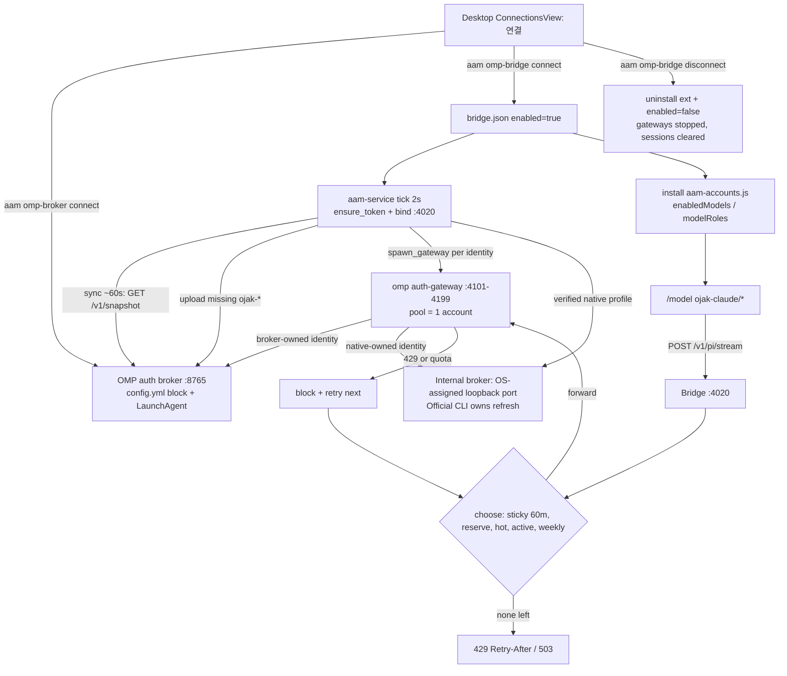
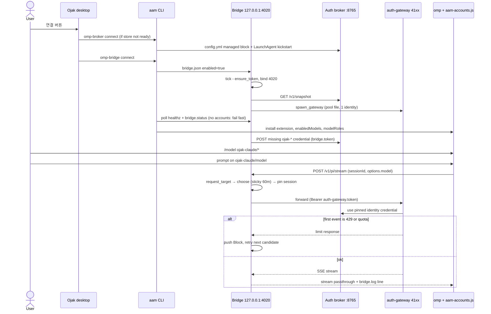

# omp-bridge

## 개요
omp의 `ojak-*` 모델 요청은 `127.0.0.1:4020` 브릿지로 오고, 브릿지가 세션마다 계정을 골라 계정별 omp gateway(4101–4199)로 넘긴다. gateway는 원래 omp auth broker(:8765) 또는 공식 CLI의 access-only 인증 소스에서 해당 계정 하나만 본다. 설계 문서: `docs/specs/2026-09-26-aam-account-bridge.md`.

Claude·Codex는 Ojak에 등록된 기존 공식 CLI 로그인과 omp의 원래 공급자 로그인 중 하나만 있으면 된다. 같은 공급자·계정·워크스페이스가 양쪽에 있으면 broker를 우선해 중복 gateway를 만들지 않는다. Gemini(Antigravity)·Grok·Z.AI는 omp의 원래 공급자 로그인을 쓴다. 사용자는 원래 로그인 한 번만 하고, Ojak은 `ojak-*` 등록과 계정 배정을 자동 처리한다. 인증이 실제로 폐기됐을 때만 그 인증을 소유한 공식 CLI 또는 omp 공급자에서 다시 로그인한다.

## 구성
- 서비스 쪽: `crates/service/src/bridge.rs` — `Bridge::start`(`:370`), `handle`(`:565`), `stream`(`:636`), `choose`(`:205`), `spawn_gateway`(`:934`)
- launcher 쪽: `crates/launcher/src/omp_bridge.rs`(`aam omp-bridge`), `omp_broker.rs`(`aam omp-broker`); Windows 로그인 자동 실행과 감독은 `omp_broker_windows.rs`.
- 공식 CLI 인증: `crates/adapters/src/access*.rs`, `crates/service/src/bridge_native.rs`. Claude는 프로필별 macOS 키체인(항목이 없을 때만 `.credentials.json`) 또는 Windows 인증 파일, Codex는 파일 기반 `auth.json`을 읽는다. Codex의 다른 저장소 모드는 오래된 파일로 대체하지 않고 명시적으로 거절한다. 프로필·워크스페이스는 읽기 전후 공식 CLI로 확인한다.
- 갱신 소유권: Claude의 공식 `/usage` 무추론 명령, Codex app-server의 `account/read {refreshToken:true}`가 원래 저장소와 잠금 규칙으로 갱신한다. Ojak은 refresh token을 복사·저장·재발급하지 않으며 access token과 실제 만료 시각만 메모리에서 중개한다.
- omp 확장: `integrations/omp/aam-accounts.js` (설치 위치 `${PI_CODING_AGENT_DIR:-~/.omp/agent}/extensions/aam-accounts`)
- 모델 목록(`aam-accounts.js`, 테스트 `node --test integrations/omp/aam-accounts.test.mjs`): ① `fetchDynamicModels`가 브릿지 `GET /v1/models`에서 해당 원래 공급자(`owned_by`) 행만 받아 `provider/` 접두어를 떼고 Ojak 공급자 목록으로 쓴다. omp가 `models.db`에 24시간 캐시하므로 다음 실행부터 시작 즉시 보인다. ② `modifyModels`는 원래 공급자 행이 있으면 같은 id를 그 정보(thinking 단계·비용)로 덮어쓰고, 없으면 ①의 행을 남긴다. 예전에는 ②만 있어서 새 omp 시작 직후 원래 공급자 채팅 모델이 오기 전에 복사돼 이미지·TTS 모델만 보이는 일이 있었다(2026-10-03).

## HTTP
| Listener / 경로 | 인증 |
|---|---|
| 공개 `127.0.0.1:4020` · `GET /healthz` | 없음 |
| 공개 `127.0.0.1:4020` · `GET /v1/models`, `GET /v1/providers`, `GET /v1/admission`, `POST /v1/pi/stream` | `Bearer <AAM_HOME/bridge.token>`, 꺼져 있으면 503 |
| 내부 `127.0.0.1:<OS 할당 포트>` · `/native/<account-id>/v1/*` | 별도 `bridge-native.token`. 공개 토큰으로 인증 정보 조회 불가. 매 요청 등록·활성·identity·프로필·원본 CLI 경로 확인 |

네이티브 소스는 omp 18.8.3의 snapshot/ETag/long-poll·refresh·disable·block 규약을 따른다. SSE snapshot은 404로 공식 long-poll fallback을 사용한다. `refresh: "__remote__"`는 원격 갱신 표식이며 실제 refresh token이 아니다. 거절된 access token은 같은 값인 동안 격리하고, 공식 갱신으로 값이 바뀐 경우에만 다시 쓴다.

공개 listener의 `/native` 경로는 404이며 내부 listener로 대신 전달하지 않는다. gateway는 자신을 띄울 때의 내부 포트를 사용하고, 내부 listener가 준비되지 않으면 공개 포트로 대체하지 않는다. 계정 제외·재등록은 캐시가 신선해도 검사하며, 갱신 결과와 long-poll 응답을 내보내기 전에 최신 DB 연결을 다시 확인한다.

### 인증 갱신과 연결 예산
- 공식 CLI·키체인·DB·소켓 I/O 중에는 인증 상태 mutex를 잡지 않는다. 같은 Source의 동시 갱신은 성공·실패 결과를 공유하며, 실패 후 3초 동안 같은 실패를 재사용한다. 프로필 경로는 등록 때의 canonical 경로를 유지하며, Source를 재생성해도 같은 프로필 worker를 겹쳐 띄우지 않는다.
- 전역 슬롯 대기 중 합류한 요청은 해당 갱신이 먼저 완료되어도 결과를 공유한다. Source는 마지막 job을 하나 보존하고 합류 직전 job과 구별한다. 완료 후 새로 들어온 강제 갱신은 이전 결과를 재사용하지 않으며, 일반 조회 결과가 강제 갱신을 대신하지 않는다.
- 인증 worker는 전역 최대 4개다. 소스마다 전역 슬롯 대기자는 하나이며 FIFO로 최대 10초(요청 마감 이내) 기다린다. 만료·취소된 요청은 새 worker를 시작하지 않는다. 시작한 worker의 전후 identity 검사·키체인·공식 CLI 갱신에는 같은 20초 deadline을 전달한다. 대기자 취소·요청 마감은 이미 공유 중인 worker를 취소하지 않는다. OS 동기 작업이 남으면 프로필 점유·permit을 유지하고 늦은 결과를 버려 시간 초과 뒤 중복 갱신을 막는다.
- 헤더 수신은 30초, 모델 대기 뒤 본문 수신은 별도 30초다. native 요청은 헤더 수신부터 합계 45초, long-poll은 그 안에서 최대 25초다. 정상 TCP write-half-close는 취소가 아니며 reset 등 명백한 오류는 대기만 중단한다. 모델 SSE에는 전체 마감을 적용하지 않고 기존 upstream 300초 idle timeout을 유지한다.
- `AAM_BRIDGE_MAX_CONNECTIONS`는 전체 상한(64–512, 기본 256)이다. native 프로필 수 `P`에 따라 짧은 내부 요청은 `min(P + 4, 16)`, long-poll은 `min(2P, 24)`를 예약한다. 공개 몫 `U`에서는 제어용 `max(8, U/16)`과 대기용 `max(4, U/8)`을 빼고 모델 스트림을 받는다. 상한은 초당 요청 수가 아니라 열린 연결 수이며 기존 스트림은 끊지 않는다.
- accept·인증 전에는 기다리지 않는다. 인증된 모델 요청만 FIFO에서 `AAM_BRIDGE_MODEL_WAIT_MS`(0–120000ms, 기본 20000ms)까지 기다리고, 자리를 얻기 전 본문을 읽지 않는다. 대기열 가득 참은 `BRIDGE_BUSY`, 대기 만료는 `BRIDGE_QUEUE_TIMEOUT`(HTTP 503)이다. 새 모델 요청의 upstream 재전송을 추가하지 않는다.
- 요청당 본문 상한은 64 MiB다. `AAM_BRIDGE_BODY_BUDGET_MB`(512–8192 MiB, 기본 2048 MiB)는 선언 길이의 8배를 예약하는 가중 본문 예산이며 JSON 파싱까지 포함한 실제 RSS의 엄밀한 상한은 아니다. 예산 부족도 모델 대기 한도 내에서 기다린다. 원본 바이트와 파싱 객체가 해제된 뒤에만 gateway로 보낼 본문 길이로 예약을 줄이고, 연결 종료·오류·취소 시 RAII로 반환한다. 환경 변수는 서비스 시작 때 읽는다.
- 내부 연결 혼잡은 `AUTH_BROKER_BUSY`, 인증 갱신은 `AUTH_REFRESH_BUSY` / `AUTH_REFRESH_TIMEOUT` / `AUTH_REFRESH_UNAVAILABLE`로 구분한다. 공식 Claude `/usage`의 `is_error`는 로그인 폐기가 확인되지 않은 `NATIVE_AUTH_UNAVAILABLE`(503), 예상과 다른 실제 추론은 `NATIVE_REFRESH_UNEXPECTED`로 차단한다. 복구 시각을 모르면 `Retry-After`를 만들지 않으며 혼잡을 한도·속도 제한 차단으로 기록하지 않는다.
- 같은 binding의 기존 gateway는 명시적으로 분류한 일시 실패로 종료하지 않는다. 계정 제외·로그인 거절·identity/프로필/인증 덮어쓰기 충돌·자격 증명 형식 오류는 계속 차단한다. 계정 scan의 일시적인 프로세스 장애도 검증된 binding만 보존하고 한도는 stale로 표시한다.
- `bridge.status`는 `connections`(lane별 수·상한·거절·listener/port), `connections.modelQueue`(대기·만료·본문 예약), `authRefresh`(active/waiting/limit), `nativeAuth[]`(익명 accountKey, 현재 단계·경과 시간, 마지막 실패 코드·단계·소요 시간, 실패·회복 횟수)를 제공한다. 단계는 실제 binding·identity·인증 환경·credential 읽기·CLI 갱신·재검증 경계에서 기록한다.
- `bridge/native outcome=auth-failure`와 `outcome=auth-recovered` 로그는 익명 키·공급자·코드·단계·시간만 남긴다. 같은 실패의 반복 로그는 억제하고 회복 때 한 번 기록한다. `outcome=`이며 `->`가 없으므로 기존 데스크톱 사용량 파서는 이 줄을 제외한다. 토큰·이메일·프로필 경로·프롬프트·CLI 원문 출력은 넣지 않는다.
- `aam-accounts.js`는 연결 거절 뒤 `/healthz`도 거절되는 경우에만 서비스 장애를 알린다. 별도의 durable admission 전송이 미전송 대기를 처리하며, 전송 결과가 불확실한 실패는 omp의 자동 재시도·fallback 대상에서 제외한다.
- `bridge.status.resources`는 압박 상태(`unknown/normal/pressure`), 표본 신선도·나이, 시스템 commit 한도·여유, 프로세스 private bytes·working set, 상태 전환·모델 거절 횟수를 제공한다. 신선한 표본이 없으면 메모리 수치는 `null`이다.
- Windows 메모리 압박 때 인증된 새 모델 요청은 대기열 승격·본문 예약 전에 `BRIDGE_RESOURCE_PRESSURE`(HTTP 503, `Retry-After` 없음)로 거절한다. 이미 확보한 스트림·본문 예약, `/healthz`·모델 목록·native 인증 경로는 유지한다. 사용자 사용량 소진으로 기록하거나 처리 중인 요청을 재전송하지 않는다. 임계값과 회복 조건은 [service-core](service-core.md#windows-복구와-런타임-진단)를 따른다.
- 연결 몫을 얻은 요청의 응답 종료는 쓰기 방향만 닫은 뒤 남은 수신 바이트를 32 KiB 고정 버퍼로 버린다. 최대 3초·무수신 250ms·본문 및 헤더 상한으로 제한해, 큰 업로드의 조기 거절이 TCP reset으로 바뀌지 않게 한다. 느리거나 악의적인 송신자는 한도에서 종료하며, 연결 상한에 도달한 accept 경로는 단일 수신 스레드를 붙잡지 않는 기존 짧은 거절 경로를 유지한다.

### 작업 보존과 실행 전 대기 (0.12.0)
- `integrations/client-forks/manifest.json`에 고정한 omp·Orca 수정본이 필요하다. `aam omp-bridge connect`와 소유 확장 갱신은 omp 버전이 일치하지 않으면 기존 설정을 변경하기 전에 멈춘다. 재현 가능한 소스는 `node scripts/prepare-client-forks.mjs <새 디렉터리>`로 준비한다.
- 확장은 Ojak 모델을 `ojak-durable-native` API로 등록하고, 준비 상태를 확인한 뒤에만 원래 pi-native 직렬화·전송을 시작한다. 기본 요청은 현재 `providerSessionId` 소유권과 `persistSession()` stable-storage fence가 필수다. 명시적 ephemeral 보조 호출은 주 대화 journal을 수정하지 않는다.
- `GET /v1/admission`은 `{version:1,ready,reason,poll_after_ms,resources}`를 반환한다. 준비 상태는 자리 예약이 아니며 최종 HTTP FIFO·본문 예산을 계속 적용한다. 모델 POST의 `X-Ojak-Admission: 1`이 없으면 `BRIDGE_CLIENT_UPGRADE_REQUIRED`로 전달 전에 거절한다.
- omp는 실제 입력과 `ojak.admission.v1` marker를 저장한 뒤 최대 15분 기다린다. 프로세스 안의 대기자는 최대 32개, 보존 context 데이터는 보수적 가중치로 256 MiB까지다(실제 RSS 상한 아님). GET 실패는 미전송 대기이며, POST는 명시적인 `admission_wait`·`submitted:false`와 허용 코드가 있을 때만 다시 대기한다. 일반 503·ECONNRESET은 재전송 근거가 아니다.
- 전송 직전에 `submitted`를 fsync하고, 응답 완료를 확인한 뒤 `completed`를 기록한다. 재시작은 같은 세션·분기의 최신 `queued` 작업만 자동 재개한다. 대기 한도에 닿은 `paused`는 `/ojak-resume`으로 명시적으로 재개한다. 취소·전송됨·결과 불명·다른 분기의 작업은 자동 재개하지 않는다. 저장 실패도 전송을 막는다.
- `before_subagent_admission`은 기존 task/eval 스케줄러 안에서, child session·worktree 등 무거운 자원을 만들기 전에 기다린다. Orca도 terminal·structured ACP/Pi 실행 전에 기존 SQLite journal에 의도를 저장하며, 호스트당 32개/4 MiB·동시 시작 1개·시작 간격 2초를 적용한다. 종료는 대기를 보존하고 명시적 취소는 재개하지 않는다.
- Orca 재시작은 기존 소유권·워크스페이스·권한을 다시 확인하고 현재 설정으로 시작 계획을 재구성한다. 저장된 shell 명령이나 환경/토큰을 그대로 실행하지 않는다. 닫힌 소유자는 자동으로 되살리지 않으며 미전송 작업은 화면에서 취소·복사·명시적 재개할 수 있다.
- 첫 structured 시작은 공급자-visible index가 생기기 전에도 workspace tab이 저장될 수 있다. 복구는 실제 tab 소유권으로 판정하고, 아직 공급자 대화를 만들지 않았다면 기존 예약 session/tab을 재사용한다. Orca의 ACP 버전 검사에는 결합된 `18.12.0-ojak.2`만 추가하며 다른 prerelease를 일괄 허용하지 않는다.

### 수정본 재현과 빌드 범위
- 현재 소스 후보 버전: Ojak `0.16.2`, omp `18.12.0-ojak.2`, Orca `1.5.0-ojak.3`(upstream `v1.4.227`). 패치와 각 upstream MIT 라이선스는 `integrations/client-forks`에 있다. 이 버전 표는 설치·빌드 검증 완료를 뜻하지 않는다.
- `node scripts/prepare-client-forks.mjs --check`는 패치 해시만 검사한다. `node scripts/prepare-client-forks.mjs <새 디렉터리>`는 공식 tag를 clone하고 commit 일치·`git apply --check` 후 패치를 적용한다. 빌드·설치·기존 checkout 변경은 하지 않는다.
- 일반 `omp update`와 시작 시 업데이트 안내는 공개 stable Ojak Release의 `omp-compatible.json`만 사용한다. 동일 릴리스의 두 OS asset 이름·크기·SHA-256과 admission protocol 1을 검사하고 기존 atomic replacement·버전 검증·rollback으로 설치한다. `--check`는 대상 파일을 바꾸지 않고 `--force`도 검증을 생략하지 않는다. `--canary`·누락된 manifest·네트워크 오류는 실행 파일을 유지하고 이유를 표시하며 upstream 배포판을 대신 설치하지 않는다. 빌드·draft 절차는 [릴리스 정책](../release-policy.md#배포-위치)을 따른다.
- 각 upstream의 lockfile·native 빌드 전제조건을 따른다. 이번 Windows 검증은 Bun `1.4.3`으로 omp의 `packages/coding-agent`에서 `bun run build`, Orca에서는 `node config/scripts/run-electron-vite-build.mjs`를 실행했다. omp의 native addon은 해당 upstream `18.11.0` ABI, Orca의 native addon은 Electron `43.7.5` ABI가 필요하다.
- Windows native 모듈 빌드에는 C++ toolchain과 Python이 필요하다. 긴 checkout/pnpm 경로에서는 MSBuild의 260자 중간 파일 경로 제한을 확인했으므로 짧은 checkout/build 경로를 사용한다. 생성된 `out`은 검증용 번들이며 release installer 검증을 대신하지 않는다.
- 실행 시나리오·테스트 결과·설치하지 않은 범위는 [작업 보존 설계](../specs/2026-10-16-durable-admission.md#검증)에 기록했다. 구형 세션은 새 POST 규약을 제공하지 않으므로 세 수정본을 함께 반영하고 세션 전환 시점을 조율해야 한다.

## 공급자 ID
- 현재: `ojak-claude`→`anthropic`, `ojak-codex`→`openai-codex`, `ojak-antigravity`→`google-antigravity`, `ojak-grok`→`xai-oauth`, `ojak-zai`→`zai` (`bridge.rs:33-39`)
- 이전 `aam-*`는 `LEGACY_ALIASES`(`bridge.rs:41-47`)로 요청만 계속 받는다. 이름을 바꾸기 전 떠 있던 omp 세션용.
- 같은 표가 여러 곳에 있다: `bridge.rs` ALIASES, `aam-accounts.js` PROVIDERS, `aam-observer.js` BRIDGE_PROVIDERS/DIRECT_PROVIDERS, `omp_bridge.rs` OJAK_PROVIDERS/RENAMED, 데스크톱 `state.ts` providerAliases, `ConnectionsView.tsx` bridgeProviderOrder. 하나를 바꾸면 전부 바꾼다.

## 계정 선택 규칙
- 세션 고정: 대화 요청이 처리될 때마다 `last_used`를 갱신하고, 60분(`STICKY_MS`) 동안 대화 요청이 없을 때만 풀린다. 고정은 turn 요청(`options.model` 있음)만 만들고, 보조 요청은 같은 세션 고정을 따른다. 60분은 공급자 캐시 유지 시간을 측정해 정한 값이 아니라 추정치다.
- 캐시 우선: 고정된 대화는 안전 여유량 안쪽이어도 같은 계정에 머문다. 공급자 캐시는 조직(Anthropic은 workspace) 단위로 분리되므로 다른 계정으로 옮기면 캐시를 다시 쌓을 가능성이 높다(계정별 실측은 아직 없음). 해당 모델 한도 소진·차단·gateway 장애로 후보에서 빠질 때만 옮긴다.
- 스트림이 시작되면 계정을 바꾸지 않는다. 첫 응답이 명시적인 한도 거절이면 기존 후보 선택을 유지한다. gateway 연결 자체가 실패해 미전송이 확실할 때만 다른 후보를 시도한다. 헤더·본문 쓰기나 응답 헤더 읽기 실패는 `BRIDGE_EXECUTION_UNKNOWN`으로 끝내며 다른 계정에 재전송하지 않는다.
- 여유량은 새 대화(또는 고정이 풀린 대화)의 순위에만 쓴다. **소프트**: 여유 있는 계정이 없을 때만 여유량 안쪽 계정을 쓴다. 모델 전용 한도도 소진·여유량·소진 속도 판정에 들어간다(`scheduler::applies`).
- AAM에서 끈 계정은 브릿지에서도 제외된다.
- 차단: quota 30분 / rate limit 60초 또는 버킷 reset까지 (`bridge.rs` `QUOTA_BLOCK_MS`·`RATE_BLOCK_MS`). 관측한 리셋 시각이 있거나 응답이 더 긴 대기(`retry-after-ms` 등)를 알려 주면 그 시각까지 막는다. 둘 다 없어 30분/60초 기본값을 쓴 차단은 `Block.estimate`(Ojak의 추정)로 표시한다. 막힌 시각이 공급자 리셋이 아니라는 뜻이다.
- 한도 차단 뒤 새로 조회한 사용량에서 해당 범위의 한도 회복이 확인되면 주기 감시에서 차단을 해제한다. 차단 이전 관측·오래된 값·확인 불가·다른 모델의 회복으로는 해제하지 않으며, 요청 속도 제한 차단은 유지한다. 요금제 변경만으로 한도 증가를 추측하지 않고 실제 사용량 응답을 따른다.
- 모두 못 받을 때(`stream`의 `choose` 실패): 후보마다 `classify`로 이유를 정하고(`Cause`: `Disabled` 배정에서 뺌 / `Down` gateway 중단·15초 unhealthy / `Wait{until,quota,known}` 한도 소진·한도 응답 차단·속도 제한 / `Ready`) `summarize`가 가장 빠른 시각과 `known`(공급자 시각) 여부, 전부 사용량 한도인지(`all_quota`)를 돌려준다. 장애(`Down`)나 시도 안 한 후보(`Ready`)가 하나라도 있으면 `None`이라 429를 만들지 않고 기존 503/마지막 한도 응답 경로로 간다. 배정에서 뺀 계정은 판단에서 뺀다.
- 429 본문(`quota_message`): `type: rate_limit_error`, 한국어 해요체, 제품명 Ojak. 공급자가 알려 준 시각이면 `HH:MM부터 다시 쓸 수 있어요`(다른 날이면 `M월 D일 HH:MM부터`, 지역 시각을 못 구하면 `약 N분/시간 뒤부터`), Ojak의 추정이면 `리셋 시각을 몰라서 약 N분 뒤 다시 확인해 볼게요`, 속도 제한이 섞였으면 한도를 다 썼다고 말하지 않고 `약 N초 뒤 다시 확인해 볼게요`. 다음 행동으로 `/model`과, 지금 gateway가 떠 있는 다른 공급자(`running_alternatives`)의 `ojak-*` ID만 안내한다(없는 공급자는 말하지 않는다). 사용량 한도로 말하는 두 경우에는 끝에 `(usage limit reached)`를 붙인다. omp가 이 영어 문구(`usage.?limit` 정규식, omp 바이너리에서 확인)로 사용량 한도를 판별하기 때문이다. `Retry-After`는 아는 시각까지의 초이며 추정이어도 늘리지 않는다. omp가 `retry.maxDelayMs`(기본 300000ms)보다 긴 대기를 받으면 재시도 없이 멈추는 것은 omp 동작이다.
- 추가 과금 경로 fallback(옵트인, `use_credits_after_limit`=openai-codex 크레딧, `use_extra_usage_after_limit`=anthropic 추가 사용량): `choose`는 구독 한도가 남아 쓸 수 있는 후보가 하나도 없고(일시 차단·gateway 장애로 못 쓰는 한도 남은 계정이 있으면 기다린다) 한도 소진만이 이유이며 소진 관측이 신선하고(`stale_after_seconds`, 리셋 시각이 남음) 모델 전용 한도가 아닌 후보 중 `Candidate.paid_fallback`(정책이 켜져 있고 같은 계정의 신선한 관측이 그 경로를 명시)이 있는 계정만 고른다. 요청마다 새로 계산하므로 한도가 리셋·회복되면 다음 요청부터 구독 계정이 이기고, 그 계정에 붙어 있던 세션 고정은 eligible에서 빠지는 즉시 풀린다. 크레딧 계정이라는 이유로 고정을 예외 취급하지 않는다. 두 옵트인이 모두 꺼져 있으면(기본) 선택은 바뀌지 않는다. 한계: Ojak은 자신이 라우팅하는 새 요청만 통제한다. 이미 시작된 스트림이나 직접 실행 중인 공식 CLI 세션의 과금 전환은 공급자가 정한다. omp 사용량 보고는 Codex 크레딧을 싣지 않으므로(`resetCredits`는 리셋권으로 다른 기능) openai-codex 크레딧 데이터는 공식 Codex CLI 프로필(`account/rateLimits/read`)이 있는 계정에서만 온다.
- 크레딧·추가 사용량 스위치는 **사용 현황 → 크레딧·추가 사용량 설정**에 항상 표시한다(접힌 계정 고르기 메뉴 밖). Codex 공식 관측의 `ordinaryUsageAllowed`가 참이 아니면 동의 스위치만으로 과금 경로를 열지 않는다. 현재의 공급자 허용 여부를 최근 확인하지 못했으면 미확인으로 표시한다.
- 같은 native 도구·identity를 다른 프로필로 명시 등록하면 `ACCOUNT_ALREADY_CONNECTED`로 거절한다. 같은 프로필 재등록은 기존 규칙대로 처리하며, 다른 workspace identity·다른 도구는 허용한다. 이미 저장된 중복 프로필은 삭제하지 않고 동일 로그인·한도 공유로 표시한다.

## 연결 흐름
1. `aam omp-broker connect`가 먼저 필요(`BROKER_REQUIRED`). broker는 `~/.omp/agent/config.yml` 관리 블록을 사용한다. macOS는 LaunchAgent `ai.aam.omp-broker`로 감독한다. Windows는 `omp-broker-service.json`에 검증된 omp 경로를 기록하고 로그인 때 뜨는 `aam-service`가 창 없이 broker를 띄워 감시한다(작업 스케줄러·`conhost --headless`는 서명 없는 바이너리에서 백신 행위 탐지를 불러 쓰지 않는다). 이전 버전이 만든 앱 소유 작업은 정의 hash가 소유 기록과 같을 때만 한 번 지우고, 다르거나 지울 수 없으면 `BROKER_AGENT_CONFLICT`로 멈춘다. 첫 기동은 최대 90초 걸릴 수 있고, 터미널에서는 진행을 보여 준다.
2. `bridge.json {enabled:true}` 쓰기. 등록된 Claude·Codex 공식 로그인과 omp의 원래 공급자 로그인이 모두 없을 때만 `BRIDGE_NOT_READY`로 바로 끝난다. 이미 공식 CLI에 로그인한 사용자에게 omp 중복 로그인을 요구하지 않는다. 계정은 있는데 gateway가 아직 뜨는 중이면 최대 30초 동안 healthz·gateway·token을 기다린다.
3. 확장 설치 → `enabledModels`에 `ojak-*/*` 추가(목록이 비어 있지 않을 때만) → `modelRoles`의 `aam-*` 참조를 `ojak-*`로 변경. Ojak 로그인은 연결 때가 아니라 서비스 `sync`(약 60초, gateway가 아직 안 떠 있으면 더 자주)가 맞춘다. 실행 중인 원래 공급자 gateway가 있고 broker에 `ojak-*`가 없으면 브릿지 토큰을 올린다. 이전 `aam-*` 로그인도 새 ID로 맞추고, 있는 자격 증명은 지우지 않는다(`missing_ojak_logins`).
- 설치본 업데이트 후 앱 시작 시 기존 계정·관측 확장만 새 소스로 맞춘다. `extensionInstalled`는 소유권만이 아니라 현재 소스와 일치해야 참이다. 이 유지보수는 해제된 확장을 새로 설치하거나 기존 인증·모델 역할을 바꾸지 않으며, 수정된 사용자 파일은 덮어쓰지 않는다.
- broker snapshot의 `credentials` 배열에서 공급자 존재와 OAuth 계정 identity를 따로 읽는다. `ojak-*` 자격 증명의 `identityKey`는 null일 수 있으므로, identity가 없다는 이유로 공급자를 누락하거나 매 sync마다 같은 로그인을 다시 등록하지 않는다. 잘못된 snapshot 형식은 빈 계정 목록으로 처리하지 않고 기존 gateway를 유지한다.
- 공급자 계정이 어느 인증 소스에도 없고 후보 gateway도 없으면 `401 / UPSTREAM_AUTH_REQUIRED`를 돌려준다. 공식 CLI의 인증 실패·계정 변경·배정 꺼짐·키체인 잠금·파일 접근 오류는 별도 코드와 해결 행동으로 구분한다. 최초 조회 전·gateway 장애·한도 소진을 미로그인으로 단정하지 않는다.
- 오류 본문은 `{error:{type,message,code?}}` 형식이다. omp의 pi-native 처리기가 메시지만 읽을 수 있어 advisor·judge 경고에 JSON 전체가 노출되지 않는다. 인증·연결 오류는 요청한 omp 화면과 Ojak 연결 화면에 표시한다. OS 알림은 기존 한도 리셋 전 알림만 사용하며 인증 실패마다 중복 알림을 보내지 않는다.
- JS `JSON.stringify`가 보존하는 단독 UTF-16 surrogate escape는 Rust 문자열로 표현할 수 없다. 최초 파싱 실패 시에만 JSON 문자열 내부의 단독 surrogate를 `U+FFFD`로 치환해 재파싱한다. 정상 문자 쌍·이스케이프된 리터럴 백슬래시·나머지 필드는 보존하며 원본 세션 파일은 수정하지 않는다. 정상 요청에는 추가 순회·복사가 없고 네트워크 재전송도 없다.
- 복구 뒤에도 JSON 파싱이 실패하면 `BRIDGE_INVALID_JSON`(HTTP 400, `submitted=false`, `retryable=false`)이다. `category`(Eof/Syntax/Data/Io), `line`, `column`, `declaredLength`(없거나 숫자가 아니면 null), `receivedLength`만 제공한다.
- 종료 화면의 최근 15분 omp 사용 안내와 관리 CLI 세션 보호는 별개다. `PREPARED/STARTING/ACTIVE/SUSPECT/ORPHANED`는 사용 중지를 막고, 종료 확인 전까지 슬롯을 유지한다. UI는 사용 중지 버튼을 비활성화하고 해당 터미널 종료 또는 `앱만 종료`를 안내한다.
- **모델 설정 점검(0.14.0):** 연결 → omp → `모델 설정 점검`은 `aam omp-bridge check-models`를 명시적으로 실행한다. `omp config get retry.modelFallback|retry.fallbackChains --json`과 `omp models --kind all --json`을 읽어 `{modelFallback,unknownSources}`를 반환한다. 역할 키(사용자 역할 포함)는 모델 id로 검사하지 않고, `provider/*`·`provider/prefix/*`는 같은 공급자의 id 접두어로 검사한다. 누락 모델을 나열하고 자동 fallback이 꺼진 경우에도 시작 경고가 날 수 있음을 안내한다. 대상 fallback 배열·역할에 배정한 모델까지 검증하는 기능은 아니며, 카탈로그가 비거나 조회에 실패하면 `OMP_MODELS_UNAVAILABLE`로 알린다. 기존 5초 상태 폴링에는 모델 조회를 추가하지 않으며 인증·설정·실행 중인 서비스는 변경하지 않는다.

## 주의
- gateway는 상속된 `OMP_*`/`PI_*` 환경을 지우고 전용 `PI_CODING_AGENT_DIR=<AAM_HOME>/bridge/agent`로 띄운다. 안 그러면 사용자 설정이 요청을 다시 브릿지로 돌려 루프가 된다 (`bridge.rs:946-973`).
- `logs/bridge.log` 줄 형식은 데스크톱 사용량 화면이 그대로 파싱한다 (`apps/desktop/src-tauri/src/main.rs`의 `parse_usage_line`). 형식을 바꾸면 그 파서도 고친다. 줄 종류는 요청·차단·거절·포화이며, 사용량은 `->`가 있는 요청 줄만 센다.
  - 요청: `<ms> <provider>/<model> session=<끝8자> turn=<bool> tools=<n> -> <계정별칭12hex> [reserve-fallback]`
  - 차단(한도 응답을 받아 계정을 막을 때): `<ms> <provider>/<model> session=<끝8자> outcome=blocked account=<별칭> kind=<quota|rate> scope=<모델범위|-> until=<ms>:<provider|estimate>`
  - 거절(모든 후보가 못 받아 429/503으로 끝낼 때): `<ms> <provider>/<model> session=<끝8자> outcome=rejected reset=<ms>:<provider|estimate>|- causes=<별칭>:<코드>[:<until ms>],…`. 코드는 `quota`(관측 소진+공급자 리셋) / `cooldown`(리셋 모르고 Ojak이 건 30분 대기) / `rate`(속도 제한 차단) / `down`(gateway 중단) / `disabled` / `ready`. `reset=-`은 한도가 아닌 이유가 섞여 시각을 말할 수 없다는 뜻이다.
  - JSON 파싱 거절: `<ms> bridge/json session=- outcome=rejected category=<Eof|Syntax|Data|Io> line=<n> column=<n> declared=<n|-> received=<n>`. 본문·헤더 원문·파서 오류 원문은 기록하지 않는다. 기존 `outcome=` 제외 규칙으로 사용량 집계에서 빠진다.
  - 포화: `<ms> bridge/overload session=- outcome=overload scope=<public|native> class=<connection|model|poll> active=<n> limit=<n> suppressed=<n>`. 같은 종류는 5초에 한 줄만 기록하고 생략한 횟수를 다음 줄에 합친다. 기존 `outcome=` 제외 규칙으로 사용량·한도 차단 집계에 포함하지 않는다.
  - 이메일·조직·토큰·프롬프트는 어느 줄에도 넣지 않는다. 데스크톱 파서는 `outcome=` 칸이 있는 줄을 요청으로 세지 않는다.
- 사용 현황의 미경유 판정은 observer의 요청별 경로 근거를 사용한다. `bridge.status.sessions`는 계정 고정·프로젝트 표시용이고, 로그와 연결할 폴더가 없다는 이유로 미경유를 확정하지 않는다. 보조 세션 폴더용 `folders` 상태는 제거했다.
- `protocol/src/lib.rs:77`, `bridge.rs:104` 주석의 "models.yml `!cat`"은 옛 방식이다. 지금 확장은 `bridge.token` 파일을 직접 읽는다.

## Screen Flow / Lifecycle
<!-- screen-flows-v3: 2026-09-27, type=web-backend -->

| Stage | 상태 | 근거 |
|---|---|---|
| Create | ✅ | [bridge connection ✅] `aam omp-bridge connect` crates/launcher/src/main.rs:414 → omp_bridge.rs:218-257. Requires the broker (BROKER_REQUIRED at :220-222), write |
| Read | ✅ | [bridge connection ✅] GET /healthz without auth (bridge.rs:571-573). The RPC "bridge.status" (crates/service/src/lib.rs:403) returns Bridge::status (bridge.rs:5 |
| Update | ⚡ | [bridge connection ✅] Re-running connect is idempotent and upgrades: if the installed extension is not current, it is uninstalled and reinstalled (omp_bridge.rs |
| Delete | ⚡ | [bridge connection ✅] `aam omp-bridge disconnect` (main.rs:415 → omp_bridge.rs:259-265) uninstalls the extension, runs scope_ojak_models(false) and writes enabl |

### omp-bridge lifecycle matrix

| Entity | Create | Read | Update | Delete |
|---|---|---|---|---|
| bridge connection | ✅ | ✅ | ✅ | ✅ |
| ojak-* login | ✅ | ✅ | ⚡ | ❌ |
| sticky session | ✅ | ✅ | ✅ | ⚡ |
| gateway | ✅ | ✅ | ✅ | ✅ |

### Flow (graph)

### Sequence

### 이슈
- [medium] Delete: The ojak-* login cannot be deleted. omp_bridge::disconnect (omp_bridge.rs:259-265) removes the extension but leaves the ojak-* and legacy aam-* credentials in the broker. ConnectionsView (~:31) keeps counting them after 
- [medium] Update: The bridge token never rotates (bridge.rs:105-115). The stored ojak-* credential expires 10 years out (aam-accounts.js:50, omp_bridge.rs:89). If bridge.token is regenerated (file deleted or AAM_HOME changed), existing lo
- [medium] Delete: Disconnect reverts enabledModels (scope_ojak_models(false)) but not modelRoles. migrate_model_roles (omp_bridge.rs:160-170) moved roles to ojak-*, and they still point to that provider after the extension is uninstalled.
- [low] Delete: Gateway has no Drop impl (bridge.rs:273-304; no `impl Drop` in crates/service/src except server.rs:86). If aam-service exits without a disable tick, `omp auth-gateway` children may be orphaned and keep holding 4101-4199.
- [low] Delete: Sticky sessions only expire: memory keeps them 24h (bridge.rs:429) while pins are effective for 60m. There is no API or UI to release a pin, and the end of an omp session is not observed.
- [low] Delete: Broker disconnect exists in the CLI (main.rs:393) and Tauri (src-tauri main.rs:448-456), but the desktop only exposes bridge disconnect (ConnectionsView.tsx:41-43), so it is ⚡ for UI users.
- [low] Read: A stale comment at bridge.rs:104 says omp reads the token via the models.yml `!cat` command. The extension actually reads bridge.token directly (aam-accounts.js:27-33).
- [low] Create: The provider ID table is duplicated in at least 5 places: bridge.rs:33-47, aam-accounts.js:13-19, omp_bridge.rs:79-87, and state.ts providerAliases/directProviders plus ConnectionsView bridgeProviderOrder. Changes are no

### 다음 할 일
- [ ] Delete (ojak-* login): in omp_bridge::disconnect, remove ojak-* credentials through a broker DELETE endpoint (if the broker offers one), or show a notice that /logout is needed. Decide explicitly how long legacy aam-* credentials are kept.
- [ ] Delete (modelRoles): on disconnect, revert ojak-* role references to their upstream providers (the reverse of migrate_model_roles).
- [ ] Update (token): after token regeneration, re-upload credentials for existing ojak-* logins from the service sync (it currently uploads only missing providers), or shorten `expires` so that refreshToken runs.
- [ ] Gateway: add Drop for Gateway or a shutdown hook that stops all gateways. At sync time, detect and reclaim orphan gateways by matching the pool-file path.
- [ ] Sticky: expose a release API or UI for a session. Consider shrinking the 24h in-memory retention to about STICKY_MS.
- [ ] UI: add a broker disconnect action to ConnectionsView, or document it as CLI-only.
